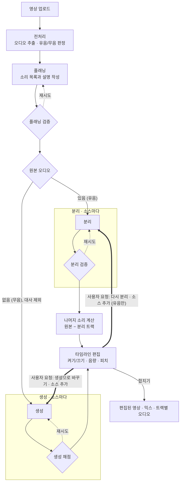
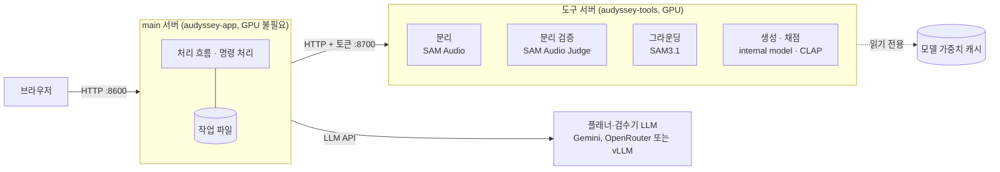
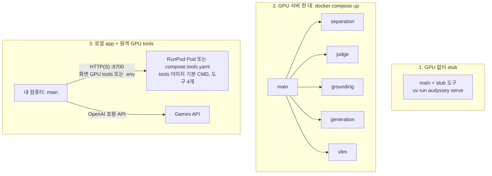

# 구조 상세

처리 흐름, 서버 구성, 용어, 계약, API를 정리한 문서입니다. 설계 원문은
[docs/superpowers/specs/2026-11-09-audyssey-skeleton-design.md](superpowers/specs/2026-11-09-audyssey-skeleton-design.md)에 있습니다.

## 처리 흐름



- 유음 영상은 분리를 기본으로 하고, 생성은 사용자가 요청할 때만 실행합니다. 분리 트랙을 생성으로 바꾸면 원래 트랙은 꺼진 채로 남아 다시 켤 수 있습니다.
- 무음 영상은 생성만 지원합니다. 대사는 생성하지 않습니다.
- 나머지 소리(residual)는 원본에서 분리 트랙만 빼서 계산합니다. 생성 트랙은 원본에서 나온 소리가 아니므로 계산에 포함하지 않습니다.
- 처리 순서는 코드에 고정되어 있습니다(LangGraph). 업로드하면 전처리까지만 하고, 사용자가 분리 시작 또는 생성 시작을 누르면 타임라인까지 진행합니다(무음 영상은 생성만). 이후 편집은 사용자가 명령을 보내 실행합니다.
- 플래닝·검수는 분리(실제 오디오 근거)와 생성(장면 적합성)을 구분합니다. 검수 오류·판정 보류를 통과로 처리하지 않으며, 재시도 한도 뒤에도 검증되지 않은 소스는 경고와 함께 건너뜁니다. 영어 프롬프트, 문맥 구간 설정, 합성 대조 평가는 [계획과 검수 개선](planning.md)을 참고합니다.

## 서버 구성



- main 서버는 GPU를 사용하지 않으며, 모델은 도구 서버와 플래너 LLM을 API로 호출합니다.
- 도구 서버 이미지 하나에 GPU 도구 네 가지가 모두 들어 있습니다. `compose.yaml`은 도구별 컨테이너로, RunPod Pod와 `compose.tools.yaml`은 컨테이너 하나로 실행합니다.
- 각 도구는 `stub`(가짜), `real`(직접 실행), `remote`(다른 서버 호출) 중에서 고를 수 있어, 담당 모듈만 실제 모델로 실행하고 나머지는 stub으로 둘 수 있습니다.
- 그라운딩(시각 힌트)은 기본으로 꺼져 있습니다.

| 구성 | 하는 일 | 실행 환경 |
|---|---|---|
| main 서버 | 흐름 실행, 명령 처리, 작업 저장, 화면. GPU를 쓰지 않음 | `audyssey-app` 이미지 (Python 3.13) |
| 도구 서버 | SAM Audio(분리), Judge(평가), SAM3(위치 찾기), 생성·채점을 HTTP로 제공 | `audyssey-tools` 이미지 (CUDA 12.8, Python 3.12) |
| 플래너 LLM | 소스 계획과 계획 검증. 주소만 바꾸면 Gemini, OpenRouter, vLLM을 오갈 수 있음 | API 또는 vLLM 서버 |

실행 방식은 세 가지입니다([실행 방법](running.md)).



화면의 **GPU tools**(`/api/gpu-tools`)는 실행 중인 main 프로세스의 도구 주소와 토큰을 바꿔 4개 도구를 모두 한 도구 서버(remote)로 연결합니다. 값은 메모리에만 남고 환경변수보다 우선합니다.

## 용어

| 용어 | 뜻 |
|---|---|
| 소스 | 소리 나는 대상 1개. 같은 대상이 소리를 3번 내면 소스 1개에 구간 3개입니다. 종류가 같아도 대상이 다르면 다른 소스입니다 |
| 분리 조건 | 텍스트 설명(필수), 구간(선택), 시각 힌트(선택: 시점, 0~1 박스, 설명) |
| 시각 힌트 | 플래너가 화면에 보이는 소스마다 만듭니다. **기본값은 사용 안 함**(`AUDYSSEY_VISUAL_PROMPT=false`). 켜면 SAM3가 대상을 찾아 나머지를 검게 칠한 영상을 만들고, 분리할 때 함께 넣습니다 |
| 분리 트랙 | 소스마다 1개. 원본과 길이가 같은 48kHz 모노 WAV |
| 생성 트랙 | 영상 길이와 같은 샘플 수(`round(duration * 48000)`)의 48kHz 모노 WAV. 설명과 seed로 생성하며 계획 구간과 시각 힌트는 사용하지 않습니다 |
| 나머지 (residual) | 원본에서 분리 트랙만 keep과 무관하게 뺀 소리. 생성 트랙은 빼지 않으며, 무음 영상에서는 만들지 않습니다. 분리 결과를 편집 없이 합치면 원본과 같습니다. `source_id="residual"`로 켜고 끄거나 음량을 바꿀 수 있습니다 |

## 검증과 재시도

| | 플래닝 검증 | 필터링 검증 |
|---|---|---|
| 검사 | 형식 검사 → `validate_plan` → (시각 힌트를 켰을 때) 힌트마다 SAM3 `locate` | `judge`가 분리 트랙을 평가 |
| 실패하면 | 문제 목록(`PlanIssue`)을 `plan(feedback=…)`에 넘겨 계획 전체를 다시 세움 | `suggestion`이 있으면 그 조건으로, 없으면 `attempt`를 1 올려 그 소스만 다시 분리 |
| 횟수 한도 | `AUDYSSEY_MAX_PLAN_ROUNDS=2` | `AUDYSSEY_MAX_SEPARATION_RETRIES=2` (최대 3번 시도) |
| 한도에 닿으면 | 검증된 소스만 처리하고, 미검증 소스는 `skipped`와 경고 표시 | 마지막 트랙을 쓰고 `filter.passed=False` 경고 표시 |

플래너와 검수기는 호출별 `planning_scope(purpose, audio_available)`로 분리/생성 목적을 받습니다. 도구 함수 시그니처와 Job JSON은 유지하며, ContextVar를 사용해 동시에 실행되는 작업의 목적이 섞이지 않도록 합니다. 앱과 Studio 모두 같은 그래프에서 이 범위를 설정합니다.

분리 검수는 오디오를 듣는 검수기(`video`와 `video_audio=true`)는 오디오로 검수하고, 오디오 입력이 없는 검수기는 시각 검수를 합니다. 시각 검수에서 시각 힌트가 없는 music·ambience 소스는 `not_validated`로 표시하며, `validation_unavailable`은 원본 오디오가 없는 작업에만 씁니다. 생성 검수는 장면 적합성을 확인하고 대사는 거절합니다. 응답은 `status=supported|unsupported|uncertain`, `evidence=audio|visual|audio_visual|none`, `reason`을 사용합니다. 잘못된 JSON은 2회 시도 뒤 `validation_error`로 남고, 검수 API의 전송 오류는 작업 실패로 남습니다. 어느 경우에도 자동 승인하지 않습니다.

검수 대상 앞뒤로 기본 0.5초의 문맥을 추가하고 영상 길이 안으로 제한합니다. 겹치는 문맥 클립은 병합하지만 실제 확인할 구간은 별도로 전달합니다. 프롬프트는 `original_time = clip_start + local_time`을 명시합니다. 세부 정책과 합성 평가 실행법은 [planning.md](planning.md)에 있습니다.

## 계약, 함수, 명령, API

**공통 데이터 형식**은 [`src/audyssey/contracts.py`](../src/audyssey/contracts.py)에 Pydantic 모델로 있습니다.
주요 모델은 `SourcePlan`, `VisualHint`, `PlanIssue`, `FilterResult`, `GroundResult`, `Job`, `Command`입니다.
오디오는 파일 경로로 주고받고, 시간은 초 단위 float입니다.

**생성 경로 계약** (이전 Job JSON은 기본값으로 읽습니다):

| 모델 | 추가·변경 |
|---|---|
| `Job` | `silent: bool = False`. 오디오 스트림이 없거나 최대 진폭이 −60dBFS 미만이면 무음. 영상 길이의 0 오디오·모노·파형 파일을 만듭니다 |
| `Source` | `origin: "separated" \| "generated" = "separated"`, `replaces: str | None = None` |
| `SourceStatus` | `skipped` 추가. 무음 영상의 대사는 트랙 없이 건너뛰며 `dialogue is not generated`를 기록 |
| `Command` | `Generate(source_id, description?)` 추가, `AddSource.method: "separate" \| "generate" = "separate"` 추가 |

유음 업로드는 기존 분리 흐름을 돌리고, 생성은 명령을 받을 때만 합니다. 무음 업로드는 플래닝·검증 후 비대사 소스를 생성합니다.
`generate`가 분리 소스를 가리키면 `<원래 이름> (generated)` 소스를 만들고 원래 소스는 지우지 않고 `keep=False`로 둡니다.
같은 분리 소스의 대체 생성 소스가 있으면 재사용합니다. 생성 소스 대상이면 그 자리에서 설명을 바꾸고 다시 생성합니다.
`attempts`는 누적되며 seed는 `AUDYSSEY_GEN_SEED + attempts - 1`입니다. 루프마다 최대 `1 + MAX_GENERATION_RETRIES`번 시도하고, 합격 시 멈추며 최고 `text_margin` 결과만 남깁니다(없으면 0, 동점이면 최신).
단계 키는 `generate:<id>`, `score:<id>`이고, 각 시도의 점수는 score 메시지와 LangSmith에 남깁니다. 채점은 기존 `FilterResult`를 씁니다.
형제 계획은 대사·자기 자신·자기가 대체하는 원본을 제외합니다. 텍스트 TargetSel만으로 합격을 판정합니다. `Source.replaces`는 대체 생성과 원래 분리 소스의 연결을 유지합니다.
real 생성은 기본 15초까지 단일 패스이며, 그보다 길면 8초 창·1초 겹침으로 처리합니다. 마지막 창은 끝에 맞추고 전체 겹침을 선형 크로스페이드합니다.
생성 뒤에는 residual을 다시 계산하지 않습니다. 원래 분리 stem을 다시 켜면 두 stem 모두 합쳐집니다.
원본 코덱 패딩과 생성 길이가 다르면 믹스에 더할 때만 겹치는 길이를 사용하며, 내보내는 stem 길이는 유지합니다.

**도구 함수**는 `stub`, `real`, `remote` 모두 시그니처가 같습니다.

```python
plan(video_path, audio_path, duration, feedback: list[PlanIssue]) -> list[SourcePlan]
validate_plan(video_path, audio_path, plans: list[SourcePlan]) -> list[PlanIssue]  # 빈 목록 = 통과
separate(mono_path, plan: SourcePlan, masked_video_path | None, out_path, attempt: int) -> out_path  # None = 텍스트만
judge(mono_path, track_path, plan: SourcePlan) -> FilterResult
locate(video: Path, hint: VisualHint) -> GroundResult
mask_video(video: Path, hint: VisualHint, out: Path) -> Path
generate(video: Path, plan: SourcePlan, out: Path, seed: int) -> Path
score_generation(track: Path, plan: SourcePlan, siblings: list[SourcePlan]) -> FilterResult
render(job: Job, job_dir, include_residual_stem: bool) -> RenderOutput
```

**명령.** 작업 상태는 명령으로만 바꿉니다(`graph.handle_command`).
버튼, 나중에 붙일 자연어 입력, 에이전트가 모두 같은 명령을 쓰게 하려는 규칙입니다.

```
keep / drop(source_id)            set_gain(source_id, 0.0~2.0)     set_pitch(source_id, -12~+12)
reseparate(source_id, description?, spans?)   generate(source_id, description?)
add_source(plan, method="separate")          render(include_residual_stem)
```

대사·residual 대상 `generate`, 무음 영상의 `add_source(method="separate")`, 대사 `add_source(method="generate")`, 생성 소스·무음 영상의 `reseparate`는 거절합니다(422, 다른 명령 검증 오류와 같음). 없는 소스는 404입니다. `generate`도 실행 잠금을 사용해 바쁜 작업에는 409를 돌려줍니다.

**main 서버 API.** UI는 아래 API만 쓰면 됩니다.

```
POST /api/jobs                    multipart(video) → Job (전처리까지만, state "new")
POST /api/jobs/{id}/start         {method: separate|generate} → Job | 409(이미 시작) | 422(무음 영상에 separate)
GET  /api/jobs                    → Job 요약 목록
GET  /api/jobs/{id}               → Job
GET  /api/jobs/{id}/events        SSE: 상태가 바뀔 때마다 Job 전송
POST /api/jobs/{id}/commands      Command → Job | 404(없는 소스) | 409(실행 중) | 422(형식·검증 오류)
GET  /api/jobs/{id}/files/{path}  작업 폴더의 오디오·영상·파형 파일
GET  /api/jobs/{id}/trace         단계별 모델 호출 기록 (입력, 프롬프트, 보낸 프레임·클립, 응답, 걸린 시간)
GET  /api/jobs/{id}/export        합친 영상, 믹스, stem을 묶은 zip (합치기 전이면 409)
GET  /api/system                  서버별로 어떤 단계와 모델이 도는지, 응답하는지
GET  /api/gpu-tools               {tools_url, token_set, remote} (토큰은 돌려주지 않음)
POST /api/gpu-tools               {tools_url, token?} → 같은 형식 | 409(작업 실행 중) | 422(http(s) URL이 아님)
```

호출 기록은 작업 폴더의 `trace.jsonl`에 쌓이고, 호출이 주고받은 파일은 `trace/<호출 id>/`에 복사됩니다. 재시도가 트랙을 덮어써도 각 시도의 결과를 들어 볼 수 있습니다.

**도구 서버 API.** `/health`를 빼면 모두 `Authorization: Bearer $AUDYSSEY_TOOL_TOKEN`이 필요합니다.

```
GET  /health                                    인증 없음
POST /separate  multipart mono, plan, attempt (+ video)     → WAV   video는 시각 힌트를 켰을 때만
POST /judge     multipart mono, track, plan                  → FilterResult
POST /locate    multipart video, hint                        → GroundResult
POST /mask      multipart video, hint                        → MP4
POST /generate  multipart video, plan, seed                   → WAV
POST /score     multipart track, plan, siblings → FilterResult
```

생성 도구도 `audyssey tool-server --tool generation --impl stub`으로 실행합니다. `siblings`는 SourcePlan 목록 JSON입니다. 생성 track만 업로드하며 업로드 이름은 저장 경로로 사용하지 않습니다. 기존 Bearer 인증·파일별 업로드 크기 제한·remote 시간 제한을 동일하게 적용합니다. `real` 생성은 팀 내부 모델(internal model)과 CLAP 채점으로 구현하며 다른 GPU 도구와 같은 `gpu/` 환경에서 실행합니다.

## 코드 위치

```
src/audyssey/
  contracts.py   팀 공통 계약 (변경은 PR로 합의)
  settings.py    AUDYSSEY_* 환경변수 (pydantic-settings)
  graph.py       LangGraph 흐름, 검증 루프, 명령 처리
  store.py       Job ↔ work/jobs/<id>/job.json
  api.py         HTTP API + 화면
  trace.py       단계별 모델 호출 기록, 서버 배치
  toolserver.py  도구 서버
  cli.py         audyssey serve | audyssey tool-server
  media.py       ffmpeg 추출·프레임·WAV 입출력
  webui/         web/ 빌드 결과 (/, git 제외. 없으면 ui/로 대체)
  ui/            이전 단일 파일 화면 (/legacy)
  devui/         개발용 화면 (/dev)
  tools/
    planning/    stub.py real.py llm.py      plan, validate_plan
    separation/  stub.py real.py remote.py   separate (SAM Audio)
    filtering/   stub.py real.py remote.py   judge (SAM Audio Judge)
    grounding/   stub.py real.py remote.py   locate, mask_video (SAM3)
    generation/  stub.py real.py remote.py   generate, score_generation
    editing/     render.py                   residual, pitch, render
gpu/             GPU 도구 전용 uv 프로젝트 (Python 3.12, numpy 1.26, torch cu128)
docker/          app.Dockerfile, tools.Dockerfile
compose.yaml     main + separation + judge + grounding + generation + vllm
compose.tools.yaml  GPU 호스트에서 도구 4개만 컨테이너 1개로
tests/           unittest (GPU 코드는 가짜 torch/sam_audio로 검사)
```

웹 앱 소스는 저장소 루트의 `web/`에 있습니다(`web/src`, 테스트는 `web/tests`, `npm run build`가 `src/audyssey/webui/`에 씁니다).
